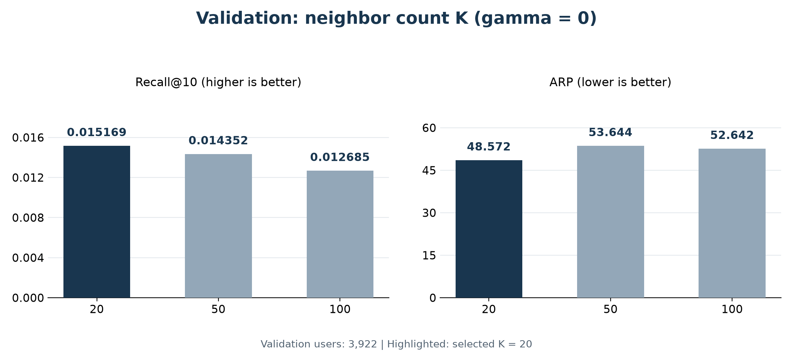
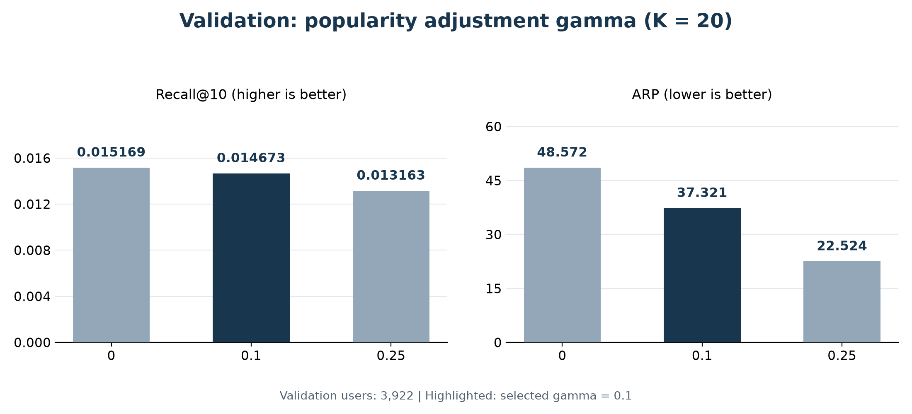
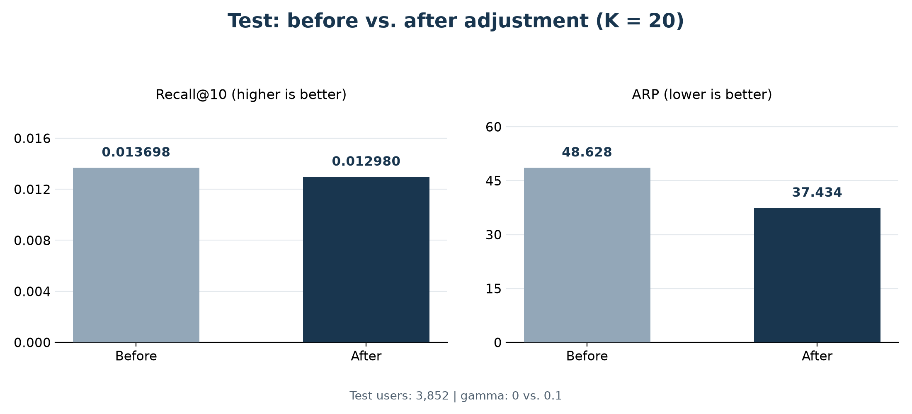

# ML-Team4 Item-Based CF

ListenBrainz 청취 이력으로 **사용자가 학습 기간에 듣지 않은 곡 10개**를 추천합니다. 곡 간 유사도를 이용해 추천 점수를 계산하고, 인기도 보정 전후의 정확도와 평균 추천 인기도를 비교합니다.

| 최종 설정                | 평가 대상               | 테스트 결과                          |
| ------------------------ | ----------------------- | ------------------------------------ |
| K=20 · log1p · gamma=0.1 | 3,852명 · 사용자당 10곡 | Recall 94.76% 유지 · ARP 23.02% 감소 |

[실행 방법](#1-실행-방법) · [모델 구현](#2-모델-구현) · [평가 결과](#3-평가-결과) · [결과 파일](#4-결과-파일) · [코드 및 테스트](#5-코드-및-테스트)

## 1. 실행 방법

모든 명령은 저장소 루트에서 실행합니다. 아래 설치 예시는 Python 3.12 기준이며, 실험은 Python 3.14.0 환경에서 수행했습니다.

### 환경 설치

```bash
python3.12 -m venv .venv
source .venv/bin/activate
python -m pip install -r requirements.txt
```

### 데이터 준비

전처리 저장소의 `datasets/listenbrainz-preprocessing.zip`을 풀고, **CSV 7개를 같은 폴더**에 둡니다. 원본 전처리와 시간 분할을 다시 수행할 필요는 없습니다.

처음 설정할 때만 환경변수 예제를 복사합니다. 이미 `.env`가 있다면 기존 파일의 경로만 확인합니다.

```bash
cp .env.example .env
```

`.env`의 `DATA_DIR`을 CSV 폴더로 지정합니다.

```dotenv
DATA_DIR=data/raw
```

| 입력 파일                                         | 용도                                                          |
| ------------------------------------------------- | ------------------------------------------------------------- |
| `train_interactions.csv`                          | 사용자·곡별 청취 횟수: `user_idx`, `item_idx`, `listen_count` |
| `users.csv`                                       | 공통 사용자 인덱스와 원본 사용자 ID                           |
| `items.csv`                                       | 공통 곡 인덱스, 곡명·아티스트명, 고유 학습 청취자 수          |
| `validation_users.csv` · `validation_targets.csv` | 검증 대상 사용자와 정답 곡                                    |
| `test_users.csv` · `test_targets.csv`             | 테스트 대상 사용자와 정답 곡                                  |

> `.env`와 `data/`의 데이터 파일, `outputs/`의 실험 결과는 Git에서 제외됩니다. 공유용 `.env.example`에는 예시 경로만 저장합니다.

### 데이터 확인

```bash
python -m item_based.data
```

```text
학습 행렬: 5,000명 × 1,525,005곡
학습 사용자·곡 쌍: 2,739,292
학습 청취 횟수 합계: 6,623,584
검증: 3,922명 / 정답 193,323쌍
테스트: 3,852명 / 정답 201,203쌍
공통 인덱스·인기도·평가 정답 검증 완료
```

<details>
<summary>경로 우선순위와 데이터 검증 항목</summary>

경로 우선순위는 `--data-dir` → 실행 환경의 `DATA_DIR` → `.env`의 `DATA_DIR`입니다. 상대 경로는 프로젝트 루트 기준입니다.

```bash
python -m item_based.data --data-dir data/raw
```

로더는 UTF-8 BOM과 CSV 이름 필드의 쉼표·따옴표·개행을 처리하고, `NA`·`NULL` 문자열을 그대로 보존합니다. 공통 인덱스를 유지하며 인덱스 범위, 중복 사용자·곡 쌍, 양수 청취 횟수, 학습 인기도, 평가 사용자와 정답 연결을 검사합니다. 평가 정답에 사용자의 학습 청취곡이 포함되거나 후보가 10곡 미만이면 오류로 처리합니다.

로더는 원시 청취 횟수를 반환하며, 로그 변환은 모델 학습 단계에서 적용합니다.

</details>

### 추천 및 평가 실행

**사용자 한 명의 추천** — 곡명·아티스트명과 함께 CSV로 저장합니다.

```bash
python -m item_based --real-data \
  --top-k 20 --weighting log1p --gamma 0.1 \
  --user-idx 0 \
  --output outputs/recommendations_user_0.csv
```

**검증 평가** — 전체 검증 사용자로 K·gamma를 비교합니다.

```bash
python -m item_based.evaluate \
  --top-k 20 --weighting log1p --gamma 0.1 \
  --output-dir outputs/validation_k20_gamma01
```

**최종 테스트 비교** — 한 번 학습한 모델로 보정 전 gamma=0과 보정 후 gamma=0.1을 평가합니다.

```bash
python -m item_based.evaluate \
  --split test \
  --top-k 20 --weighting log1p \
  --compare-gamma 0.1 \
  --output-dir outputs/test_k20
```

모델을 파일로 저장하는 기능은 아직 없어 **명령을 새로 실행하면 재학습**합니다. 저장된 결과를 확인할 때는 재실행할 필요가 없습니다. 같은 출력 폴더를 지정하면 기존 결과를 갱신합니다.

<details>
<summary>데이터 없이 예제 실행</summary>

```bash
python -m item_based --output outputs/demo_baseline.csv
python -m item_based --gamma 0.5 --output outputs/demo_adjusted.csv
```

`--real-data`가 없는 추천 명령은 내장 예제 데이터를 사용합니다. 출력 컬럼은 `user_id`, `rank`, `track_id`, `score`, `popularity`이며, 출력되는 지표도 예제 데이터의 결과입니다.

</details>

## 2. 모델 구현

### 추천 과정

| 단계             | 처리 내용                                                                               |
| ---------------- | --------------------------------------------------------------------------------------- |
| ① 청취 행렬 구성 | 공통 `user_idx`·`item_idx`로 사용자 × 곡 희소 행렬 생성                                 |
| ② 입력 변환      | 반복 청취의 영향을 완화하도록 `log1p(청취 횟수)` 적용                                   |
| ③ 유사곡 선택    | 모든 사용자를 축으로 코사인 유사도 계산, **후보 곡 기준** 자기 자신을 제외한 Top-K 선택 |
| ④ 점수 계산      | 이웃 유사도와 사용자 선호 강도의 가중평균 계산                                          |
| ⑤ 인기도 보정    | 예측 점수를 고유 학습 청취자 수의 gamma승으로 나눔                                      |
| ⑥ Top-10 추천    | 학습 청취곡 제외 후 점수순으로 서로 다른 10곡 선택                                      |

### 점수 계산

사용자 `u`, 후보 곡 `m`, 후보 곡의 이웃 집합 `N(m)`에 대해 계산합니다.

```text
X[u,j] = log(1 + listen_count[u,j])

prediction(u,m) = Σ(S(m,j) × X[u,j]) / Σ S(m,j)     j ∈ N(m)

adjusted(u,m) = prediction(u,m) / popularity(m)^gamma
```

`S(m,j)`는 곡 간 코사인 유사도, `popularity(m)`은 해당 곡을 들은 **고유 학습 사용자 수**입니다. 총 재생 횟수와는 다릅니다.

미관측 이웃 입력은 0으로 표현하되 실제 비선호를 의미하지는 않습니다. 분모는 후보 곡이 선택한 이웃 전체의 유사도 합이며, 합이 0이면 예측 점수도 0입니다. 동점이면 공통 곡 인덱스 오름차순으로 선택하고, 양수 점수 후보가 부족하면 나머지 0점 후보로 채웁니다.

### 주요 옵션

| 옵션              | 기본값       | 의미                                                     |
| ----------------- | ------------ | -------------------------------------------------------- |
| `--top-k`         | `50`         | 자기 자신을 제외한 곡별 이웃 수. 최종 실험 설정은 **20** |
| `--weighting`     | `log1p`      | `log1p`: 로그 변환 / `raw`: 입력값 그대로 사용           |
| `--gamma`         | `0`          | 인기도 보정 강도, 범위 0~1. 0이면 보정 없음              |
| `--batch-size`    | `128`        | 유사도 계산 블록 크기                                    |
| `--split`         | `validation` | 평가 명령의 대상 기간: `validation` 또는 `test`          |
| `--compare-gamma` | 미지정       | 테스트에서 gamma=0과 지정한 gamma를 같은 모델로 비교     |

<details>
<summary>희소 연산과 메모리 처리</summary>

전체 곡×곡 dense 행렬을 만들지 않고 블록 단위로 유사도를 계산해 Top-K만 저장합니다. 점수는 float32, 이웃 인덱스는 데이터 규모에 맞는 정수 배열을 사용합니다. 상위 K개는 경계 점수를 먼저 찾은 뒤 동점을 곡 인덱스로 처리하고, 선택된 곡만 정렬합니다.

이웃 행렬 `N[m,j]`는 후보 m이 선택한 이웃 j의 유사도입니다. Top-K 선택 후에는 대칭이 보장되지 않으므로 예측 분자는 `X @ N.T`로 계산합니다. 예측에 쓸 전치 CSR과 후보별 유사도 합을 학습 단계에서 준비합니다. 전치 시 임시 배열이 공존할 수 있으며, CSR 크기가 프로세스 최대 메모리를 뜻하지는 않습니다.

K=50의 이웃 저장 버퍼는 최대 약 588 MiB이며 입력·정규화 행렬·임시 블록은 별도 메모리를 사용합니다. `--batch-size`를 낮추면 블록 작업 공간은 줄일 수 있지만 최종 이웃 행렬 크기는 줄지 않습니다. 단일 사용자 실제 추천 명령은 학습 시간, 이웃 CSR 크기와 지원 환경의 최대 RSS를 측정 파일에 기록합니다.

</details>

## 3. 평가 결과

### 데이터 분할 및 지표

| 구간       | 기간 (2026년, UTC·양끝 날짜 포함) | 용도                    | 평가 사용자 |
| ---------- | --------------------------------- | ----------------------- | ----------: |
| Train      | 8월 17일 ~ 9월 27일               | 행렬·유사도·인기도 계산 |           — |
| Validation | 9월 28일 ~ 10월 4일               | K·gamma 선택            |     3,922명 |
| Test       | 10월 5일 ~ 10월 11일              | 고정한 설정의 최종 비교 |     3,852명 |

#### 데이터별 활용

| 데이터         | 실제 사용 방법                                                                                                                        | 청취 행렬·유사도 계산에 반영 |
| -------------- | ------------------------------------------------------------------------------------------------------------------------------------- | ---------------------------- |
| **Train**      | 사용자별 청취 횟수 행렬을 만들고, 곡 유사도·Top-K 이웃·고유 청취자 수를 계산합니다. 추천에서 제외할 기존 청취곡도 train으로 정합니다. | **반영**                     |
| **Validation** | train으로 만든 모델의 추천을 검증 기간의 실제 청취곡과 비교합니다. Recall@10·ARP를 보고 K와 gamma를 선택합니다.                       | 반영하지 않음                |
| **Test**       | 선택한 K·gamma를 고정한 뒤, 테스트 기간의 실제 청취곡으로 보정 전후를 최종 비교합니다.                                                | 반영하지 않음                |

학습에는 `train_interactions.csv`만 사용합니다. 평가에서는 `validation_users.csv` 또는 `test_users.csv`로 대상 사용자를 정하고, 같은 기간의 `*_targets.csv`에서 사용자별 정답 곡을 가져옵니다. 정답은 해당 기간에 실제로 들은 곡 중 **학습 카탈로그에 있으면서 그 사용자의 train 이력에는 없는 곡**입니다.

실험은 **train으로 모델 구성 → validation으로 설정 선택 → test로 최종 확인** 순서로 진행했습니다. K를 바꿀 때마다 같은 train에서 이웃을 다시 계산했고, gamma는 계산된 추천 점수의 인기도 보정에 사용했습니다. gamma만 달라도 기존 검증 명령은 매 실행마다 재학습하지만, 최종 테스트 비교 명령은 모델을 한 번만 학습해 보정 전후에 재사용합니다.

최종 테스트에서도 train과 validation을 합치지 않았습니다. 추천에서 제외하는 곡은 원래 train 청취곡뿐이므로, validation에서 들었던 곡이 test의 정답이나 추천에 다시 등장할 수 있습니다. test 결과는 설정 선택에 사용하지 않았습니다.

#### 지표 계산

| 지표            | 사용자별 계산                          | 전체 집계        |
| --------------- | -------------------------------------- | ---------------- |
| **Recall@10 ↑** | 추천 10곡과 정답의 교집합 수 / 정답 수 | 평가 사용자 평균 |
| **ARP ↓**       | 추천 10곡의 고유 학습 청취자 수 평균   | 평가 사용자 평균 |

후보는 **전체 학습 카탈로그 − 해당 사용자의 원래 train 청취곡**입니다. 0점 추천과 Recall이 0인 사용자도 포함합니다. 10곡 미달, 중복, 학습 청취곡 포함 또는 유효하지 않은 점수가 있으면 평가를 중단합니다.

### 검증 ①: K 선택 — gamma=0 고정

인기도 보정을 끈 상태에서 이웃 수 K만 바꿔 비교했습니다. 입력 변환은 모두 `log1p`이며, 동일한 검증 사용자와 정답을 사용했습니다.



비교한 세 설정 중 Recall이 가장 높고 ARP가 가장 낮은 **K=20**을 선택했습니다.

### 검증 ②: gamma 선택 — K=20 고정

선택한 이웃 수를 유지하고 인기도 보정 강도 gamma만 바꿔 비교했습니다. gamma=0을 보정 전 기준으로 사용했습니다.



보정 전 대비 gamma=0.25는 Recall이 약 13.2% 감소했습니다. gamma=0.1은 Recall이 약 3.3% 감소하면서 ARP가 약 23.2% 감소해, 정확도 감소와 평균 추천 인기도 감소를 함께 고려한 최종 보정 강도로 선택했습니다. 최종 테스트에서는 **K=20·gamma=0.1**을 고정했습니다.

### 테스트: 보정 전후 비교

설정을 고정한 뒤 최초 train만으로 한 번 학습했습니다. validation을 학습에 합치거나 validation 청취곡을 후보에서 추가로 제외하지 않았습니다. 보정 전후 동일한 테스트 사용자 3,852명에게 각각 10곡씩, 총 38,520곡을 추천했습니다.



> **보정 전 Recall의 94.76%를 유지하면서 추천 곡의 평균 학습 인기도를 23.02% 낮췄습니다.**

정확도 감소와 평균 추천 인기도 감소가 함께 나타났습니다. ARP 감소만으로 실제 만족도가 향상됐다고 판단하지 않으며, 여기서 인기도는 전체 음악 시장이 아닌 학습 표본의 고유 청취자 수입니다. 테스트 결과로 설정을 다시 선택하지 않았습니다.

사용자별·추천 CSV로 지표를 재계산해 최종 요약과 일치함을 확인했습니다. 보정 전후 모두 0점 추천 524개와 이를 포함한 사용자 78명을 평가에 포함했습니다.

## 4. 결과 파일

평가 원본과 생성 결과는 `outputs/`에 저장하며 Git에서 제외됩니다. README에 표시하는 결과 이미지 4장은 `docs/images/`에 복사해 함께 관리합니다.

### 그래프와 실행 결과 출력

저장된 검증·테스트 JSON을 읽어 발표·보고서용 출력물을 생성합니다. **데이터 로딩·학습·추천·평가는 다시 실행하지 않습니다.** Item-Based 결과만 사용하며 MF 비교 결과는 포함하지 않습니다.

```bash
python -m pip install -r requirements.txt
python -m item_based.report
```

README의 이미지도 갱신하려면 생성 후 아래 명령을 실행합니다.

```bash
mkdir -p docs/images
cp outputs/report/*.png docs/images/
```

| 생성 파일 (`outputs/report/` 기준) | 내용                                    |
| ---------------------------------- | --------------------------------------- |
| `validation_k.png`                 | gamma=0에서 K별 Recall@10·ARP 비교      |
| `validation_gamma.png`             | K=20에서 gamma별 Recall@10·ARP 비교     |
| `test_comparison.png`              | 최종 테스트 보정 전후 비교              |
| `execution_results.png`            | 저장된 실행 결과를 이미지로 정리한 요약 |
| `execution_results.txt`            | 설정·지표·변화율·원본 결과 파일 경로    |
| `results.csv`                      | 검증·테스트 결과를 모은 비교표          |

이미지는 영어 표기, 200dpi PNG로 저장합니다. 그래프의 진한 막대는 선택된 설정 또는 보정 후 결과이며, 두 지표 모두 0부터 시작하는 별도 축으로 표시합니다. `execution_results.png`는 저장된 결과 요약을 렌더링한 이미지이며 원래 훈련 터미널의 스크린샷은 아닙니다. 텍스트 요약은 터미널에도 출력됩니다.

경로를 직접 지정할 수도 있습니다.

```bash
python -m item_based.report --results-dir outputs --output-dir outputs/report
```

기본 비교 범위는 K=20·50·100, gamma=0·0.1·0.25입니다. `--k-values`, `--gammas`, `--selected-k`로 변경할 수 있으며 선택한 설정은 목록에 포함되어야 합니다. 필요한 결과가 없거나 파일에 기록된 설정·평가 조건이 다르면 오류로 처리합니다. 수치를 임의로 채우지 않습니다.

### 평가 원본 파일

| 경로                                          | 내용                     |
| --------------------------------------------- | ------------------------ |
| `validation_k20_gamma0/`                      | K=20·gamma=0 검증        |
| `validation_k50_gamma0/`                      | K=50·gamma=0 검증        |
| `validation_k100_gamma0/`                     | K=100·gamma=0 검증       |
| `validation_k20_gamma01/`                     | K=20·gamma=0.1 검증      |
| `validation_k20_gamma025/`                    | K=20·gamma=0.25 검증     |
| `test_k20/baseline/`                          | 테스트 보정 전 결과      |
| `test_k20/adjusted/`                          | 테스트 보정 후 결과      |
| `test_k20/comparison.csv` · `comparison.json` | 테스트 비교 표·전체 요약 |

각 검증·테스트 결과 폴더에는 다음 파일이 생성됩니다.

| 파일                  | 내용                                                            |
| --------------------- | --------------------------------------------------------------- |
| `summary.json`        | 설정, 전체 사용자 수, Recall@10·ARP, 평가 시간, 0점 추천 규모   |
| `users.csv`           | 사용자별 정답·적중 수, Recall@10·ARP, 0점 추천 수               |
| `recommendations.csv` | `user_idx`, `rank`, `item_idx`, `score`, `train_listener_count` |

실제 데이터의 단일 사용자 추천 CSV에는 원본 사용자 ID, 곡명·아티스트명도 함께 저장합니다. 추천 파일이 `recommendations_user_0.csv`라면 측정 파일은 `recommendations_user_0_metrics.json`입니다.

<details>
<summary>결과 파일의 상세 규칙</summary>

CSV는 UTF-8 BOM으로 저장하며, 곡명의 쉼표·따옴표·개행은 CSV 규칙으로 처리합니다. 단일 사용자 실제 추천 CSV의 컬럼은 `user_idx`, `user_id`, `rank`, `item_idx`, `artist_name`, `recording_name`, `score`, `train_listener_count`입니다. 평가 CSV의 `item_idx`는 `items.csv`와 연결해 곡명을 조회할 수 있습니다.

비교 JSON에서 `recall_change`·`arp_change`는 보정 후 − 보정 전의 절대 차이입니다. `recall_retention`은 보정 후 Recall / 보정 전 Recall, `arp_reduction`은 1 − 보정 후 ARP / 보정 전 ARP입니다. 분모가 0이면 해당 비율은 `null`입니다.

실행에 실패하면 CSV가 일부만 기록될 수 있고, 완료된 평가에만 `summary.json`이 생성됩니다. 테스트 보정 전후 평가가 모두 완료되면 `comparison.json`이 생성됩니다.

</details>

## 5. 코드 및 테스트

| 파일                                  | 역할                                            |
| ------------------------------------- | ----------------------------------------------- |
| [data.py](item_based/data.py)         | CSV 로딩·공통 인덱스 및 입력 검증               |
| [model.py](item_based/model.py)       | 로그 입력·코사인 이웃·가중평균·인기도 보정      |
| [**main**.py](item_based/__main__.py) | 예제·실제 사용자 추천과 CSV 저장                |
| [evaluate.py](item_based/evaluate.py) | 검증·테스트 평가와 보정 전후 비교               |
| [report.py](item_based/report.py)     | 저장된 결과의 그래프·비교표·실행 결과 요약 생성 |
| [tests/](tests/)                      | 계산·데이터 연결·평가 회귀 테스트               |

```bash
python -m unittest discover -s tests -v
```

작은 행렬의 직접 계산, Top-K 경계 동률, 공통 인덱스, 평가 사용자 평균, 테스트 분리와 비교 시 학습 1회 수행을 검증합니다.

<details>
<summary>Python 코드에서 모델 사용</summary>

```python
from item_based.data import load_dataset
from item_based.model import ItemBasedCF

dataset = load_dataset()
model = ItemBasedCF(top_k=20, weighting="log1p")
model.fit_matrix(dataset.counts)

for item in model.recommend_by_index(user_idx=0, gamma=0.1):
    info = dataset.items.iloc[item.item_idx]
    print(info["recording_name"], info["artist_name"], item.score)
```

`counts`는 사용자 행 × 곡 열의 CSR 행렬입니다. 모델은 복사본에 변환을 적용하므로 원시 청취 횟수는 유지됩니다. 반환 추천은 `item_idx`, `score`, `popularity`를 포함하며, 예제용 문자열 ID는 `fit()`·`recommend()`로 처리할 수 있습니다.

</details>

MF와 비교할 때는 같은 train·평가 사용자·정답·후보·학습 인기도와 사용자 평균 지표 정의를 사용합니다.
